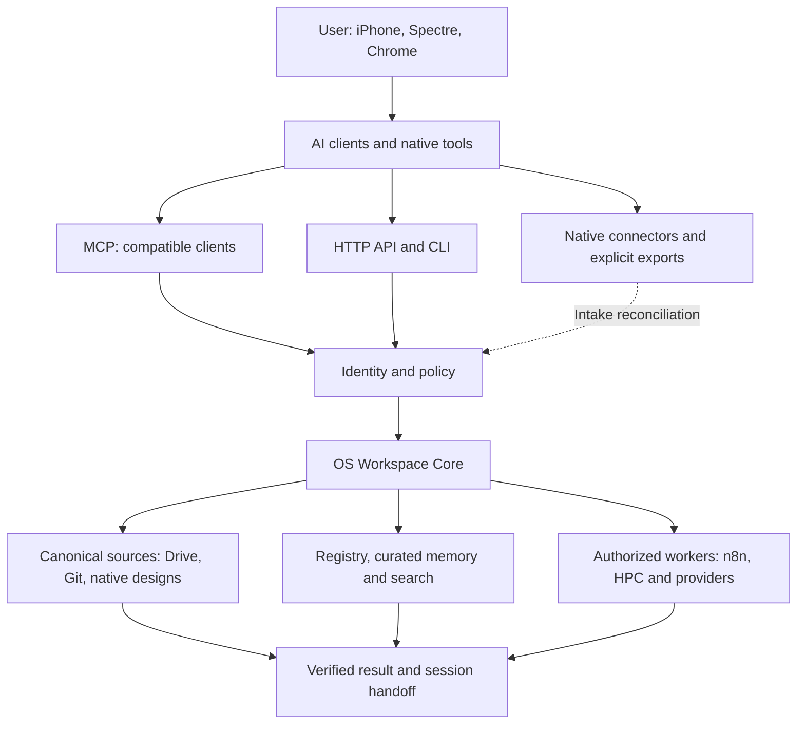

# os

OS is a project-centered workspace and shared-memory system for connecting AI platforms, documents, creative tools, devices and compute. ShivanshOS is its initial personal deployment.

The goal is continuity: create work in one tool, preserve its sources and decisions, and resume accurately in another tool without reconstructing previous chats.

## Current status

Architecture and deployment documentation are available. The workspace service, custom MCP server, automatic tagging, ingestion workers and shared-memory reconciliation are **not deployed by this commit**.

## Start here

- [Concept, wiring and deployment guide](docs/concept-wiring-deployment.md)
- [PDF deployment manual](docs/pdf/OS_Concept_Wiring_and_Deployment_Manual_v1.pdf)
- [File tagging and sorting standard](docs/file-tagging-and-sorting.md)
- [Workspace Core and MCP design](docs/workspace-core-mcp.md)
- [Implementation status and next milestone](docs/STATUS.md)
- [Diagram sources](docs/diagrams/README.md)
- [Private resource catalog deployment](docs/private-catalog-deployment.md)

The `web/` catalog is a static presentation of the repository's planned integrations and collections. It does not connect to providers or implement the Workspace Core. Its source and catalog are public in this repository; the hosted hostname must be protected by a verified Cloudflare Access policy before deployment.

The deployment guide includes manual and agent-assisted instructions for Ubuntu/Spectre, Antigravity, Chrome, iPhone, Google Drive, ChatGPT, Claude, Gemini, Perplexity, Acrobat, notebook research, local AI, n8n and supporting project tools.

## Architecture

Google Drive is the initial canonical cloud document workspace. Git remains authoritative for code, and native design platforms remain authoritative for editable designs. The registry links these sources rather than replacing them.

MCP is an interface to the workspace service; it is not the memory database. Clients without a compatible MCP connection use the HTTP/CLI interface, supported native connectors or explicit exports.

## First implementation milestone

Use Antigravity on Spectre to implement a local registry CLI with `register`, `inspect`, `classify`, `propose-route` and `export-index`. Start with read-only Drive discovery and synthetic files. Add a verified save path after identity, tagging and conflict handling work.

See section 28 of the [deployment guide](docs/concept-wiring-deployment.md) for the agent brief.

## Repository boundaries

This repository contains versioned architecture, standards, deployment instructions and implementation code as it is developed. It does not contain personal OAuth tokens, credentials, live databases, downloaded personal files, private runtime inventories or browser profiles.

Project documents and runtime data are separate. Do not synchronize a live `.git` directory or shared SQLite database through Drive. The [example workspace manifest](examples/workspace.example.json) contains placeholders, not live credentials.

No Worker hosting or service installation has been performed. The repo remains public as before; no repository visibility change or open-source license grant is implied by the catalog source.
