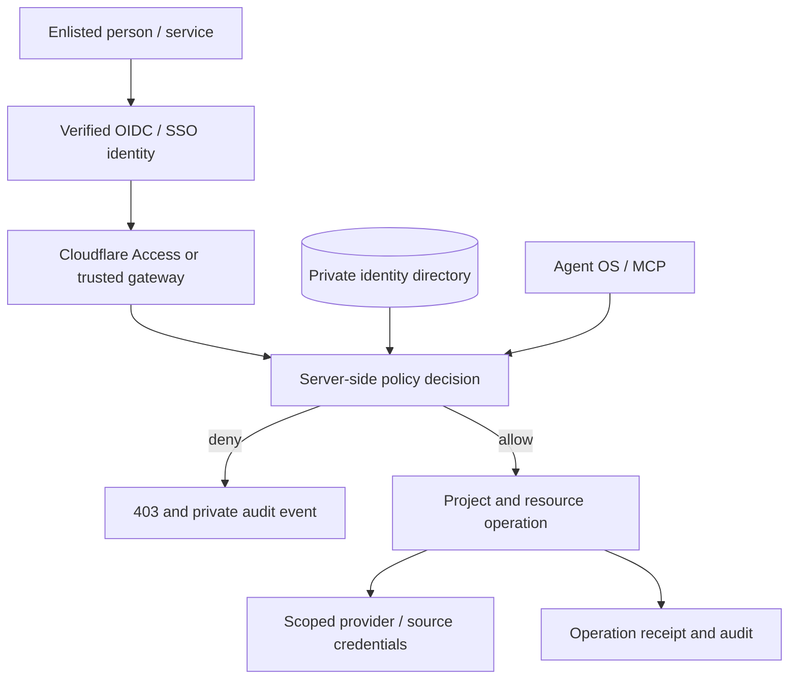

# ShivanshOS User & Address Directory — Identity and Access v0.1

**Design status (27 October 2026):** policy reference, sample records and unit tests are committed on a feature branch. No live identity records, SSO integration, provider access control, API/MCP enforcement or host deployment is claimed. The existing `os` repo is public: **never add real user data here**.

## 1. Project location and system boundary

ShivanshOS is the canonical identity, above the individual projects. Define one private identity/address directory shared by the OS Workspace Core, Agent OS and authorized connectors, with **separate project grants**:

```text
ShivanshOS/                         # logical project root
  Identity/                         # PRIVATE runtime data; never Git/public UI
    directory.sqlite3               # user, address, project grant, workload records
    audit/                           # append-only decisions and change events
    approvals/                       # signed, expiring action-bound approvals
    backups/                         # encrypted, restricted
  Projects/
    OS/
    AIO3/
    Design/
  Agents/
    Agent-OS/
  Infrastructure/
    access-adapters/
  ...
```

For HPC, an example protected private mount is `/srv/shivanshos/private/identity/`. Any `~/ShivanshOS` git clone contains only **code, policy and documentation**, never the live database. Spectre may use a local encrypted read-only replica after authentication; it must not become an independent writable source of truth.

**Root ownership does not imply project access.** Enlisting a person in the directory alone grants nothing; each project needs an active assignment. Do not automatically grant access to new subprojects.

## 2. User/address record

The private directory contains the following logical fields, with strict validation and history:

| Field | Meaning |
|---|---|
| `user_id` | Immutable internal UUID/identifier, never reused |
| `issuer` + `subject` | Stable, unique identity-provider authentication key (e.g. Auth0 OIDC) |
| `email` | **Verified** primary sign-in/contact address; must match directory record |
| `display_name`, `email_aliases` | Address-book metadata; aliases never confer login privileges |
| `persona` | Descriptive function (founder, developer, researcher, designer, mentor, collaborator, auditor); **not a permission** |
| `status` | invited, active, suspended, revoked |
| `projects` | Per-project role, explicit permissions, expiry and status |
| `mfa_policy` | Requirements for privileged operations; enforcement depends on verified IdP assurance |
| `created_by`, `approved_by`, timestamps | Enrollment and update provenance; store privately |
| `last_reviewed_at` | Grant review metadata |
| `notification_preferences` | Optional consent-based email routing, not access control |

Emails can change without changing the user's internal ID. Such changes must be reverified and reconciled in the private directory; do not transfer access based on email alone. Use an explicit, vetted migration when changing IdPs and stable subjects.

Keep **human identities**, **workload/service identities**, and **AI-agent tool identities** distinct. Every workload has a separate issuer/client ID or equivalent cryptographic identity, narrow resource scopes, an accountable human sponsor and revocation path. Do not pretend an agent is the founder.

## 3. Persona vs role vs permission

A **persona** tells the system how to present the workspace and what context is useful. A **role** is an upper limit on capabilities for a specific project. An **explicit permission grant** is also required; effective permission is the intersection of the role ceiling and listed permissions, with additional resource restrictions and approval checks.

| Role | Typical capabilities / ceiling |
|---|---|
| Owner | Project administration and resource operations; sensitive changes still require step-up and recorded approval |
| Administrator | Project admin and implementation, without automatic secret-management rights |
| Maintainer | Read, create, update, run agents, propose changes and view audits |
| Contributor | Read, create, update and propose |
| Researcher | Read, create and propose; no implementation authority |
| Viewer | Read permitted resources |
| Auditor | Read permitted resources and audit information |
| Agent | Read permitted scope and **propose** changes; no autonomous mutation |

See `identity/policy.py` for the exact role ceilings. No roles, emails or personas are wildcard grants. Project IDs (e.g. `OS`, `AIO3`, `Design`) are independent. A person who can update AIO3 cannot update OS, Design or the global directory without explicit separate assignments.

Operations include `read`, `create`, `update`, `delete`, `deploy`, `run_agent`, `propose_change`, `manage_users`, `manage_access`, `manage_secrets`, `view_audit`. `read_restricted` is an **additional gate** on reading restricted resources, not a stand-alone action. Unknown actions and unknown classifications are denied.

## 4. Enforcement sequence



Check **before** retrieving a title, search snippet, embedding, file, secret reference or resource metadata. Resolve actual resource project and sensitivity from the **server**, not caller-provided fields. Enforce at each API, MCP tool, queue worker, scheduled job and provider proxy; the front-end can hide controls but is never the security boundary.

For `delete`, `deploy`, `manage_users`, `manage_access` and `manage_secrets`, require fresh verified MFA **and** a backend-validated, time-limited approval bound to the actor, operation, target and expected revision. Separate approver from requester for privilege escalation and destructive production changes. `approval_verified` in the example evaluator is trusted backend input, never an API parameter. `Agent OS` initially has **read and propose only**, and may not submit an implementation command using a human's identity or a provider master key.

Deny on expired/revoked identity, missing enrollment, ambiguous subject, wrong issuer, unverified email, mismatched project, absent grant, insufficient role or permission, unknown classification, failed MFA, unapproved sensitive changes, or unavailable directory. Audit both successes and denials without logging tokens or secret contents. Version permissions and invalidate authorization caches rapidly on revocation.

## 5. Provider-specific integration plan

| System | Required control before claiming protected access |
|---|---|
| Auth0 | Select canonical OIDC issuer/tenant; enroll exact verified identities. Validate token signature, issuer, audience and expiry. |
| Cloudflare Access | Protect each private hostname with exact-enlisted-user/group policies; verify application JWTs at the origin. Never equate a domain-wide allow rule with enrollment. |
| Open WebUI | Disable open self-registration or keep signups pending; align provider SSO, users, groups and resource ACLs with project grants; restrict admin assignments. |
| Ollama / model gateway | Bind raw model API to localhost/private Docker network, not public `0.0.0.0:11434`; expose authorized proxy for remote access. |
| MCP + Agent OS | Verify the caller for each tool invocation; support propose-only agent capabilities until a trusted delegated-approval executor exists. |
| GitHub / Drive / Figma / Notion | Mirror effective least-privilege memberships and native ACLs; do not assume this local evaluator overrides upstream service permissions. |
| Bitwarden | Store secrets in scoped vault/collections; directory stores vault **references**, not secret values; no secret retrieval in prompts or indexes. |
| Docker / SSH / Postgres / Qdrant / n8n | Require native service-level authorization, network isolation and credentials; no publicly reachable unguarded administration ports. |

Open WebUI group permission inheritance is **additive**, and its admins may bypass resource checks. Project isolation therefore also needs server/backend gates and deliberate per-resource/private ACL configuration, not only group naming. Consult the current [Open WebUI RBAC docs](https://docs.openwebui.com/features/authentication-access/rbac/) and [group access model](https://docs.openwebui.com/features/authentication-access/rbac/groups/).

The historical OS deployment docs mention `studio.os.shivanshsethi.in` and an example exact-email Cloudflare rule. Confirm approved addresses from the owner and inspect live Access policies **before** changing them. Earlier plans also use `os.studio.shivanshsethi.in`; these are distinct hostnames and must not be conflated. This change does not alter DNS, existing workers, authorized users or the live deployment.

## 6. Enrollment, management and revocation

1. **Invite:** proposed user goes to a pending directory record, identified by email/contact. No account or resource access yet.
2. **Verify:** complete IdP sign-in, obtain trusted issuer/subject and verified primary address. Bind exactly one subject to exactly one internal user.
3. **Approve:** an enlisted directory administrator approves account activation and explicit project/role/permission grants. Record change ticket and provenance.
4. **Provision:** synchronize only allowed group memberships and provider-native ACLs; no wildcard/public privileges, including resource sharing.
5. **Use:** authenticate, authorize each resource and action, then record auditable receipts. Periodically recheck permissions.
6. **Suspend or revoke:** deny new authorization immediately, terminate active sessions where supported, revoke credentials/tokens/workload grants and remove downstream memberships.
7. **Review:** audit effective access, orphaned identities, stale grants, agent permissions and exceptions regularly.

**Bootstrap safety:** before activating deny-by-default production enforcement, verify one privately enrolled owner and offline break-glass recovery. Never add the owner automatically from the device username or from an email mentioned in documentation. If the directory is unavailable, deny access and preserve recovery via a separately protected host administration path.

## 7. Minimum production acceptance checks

- Enlisted viewer can read only the allowed project, cannot modify it, and cannot see restricted assets without explicit additional grant.
- Enlisted maintainer can update only an explicitly assigned project, with normal revision checks.
- Unlisted emails, unverified emails, revoked users, duplicate subjects, expired grants and project-crossing requests all fail.
- Agent OS can propose a project change, but cannot write/deploy or self-approve, including via a forged tool call.
- High-risk operation requires trusted MFA and approved change record; an untrusted query/body flag cannot authorize it.
- Search, embedding retrieval, downloads, direct provider APIs, long-running workers and WebUI administrative paths cannot bypass policy.
- Revocation takes effect at origin, provider ACLs and cached/long-running sessions within a documented bound.
- Break-glass controls restore authorized administration without weakening routine access.

## 8. Implementation next steps

Commit and review this specification, then build the **private** directory service and explicit enrollment interface on HPC. Implement validated OIDC authentication and server-side resource resolution, integrate the evaluator into Workspace Core/HTTP/MCP, add signed approval records and audit receipts, then connect Open WebUI and Cloudflare Access after checking actual existing configurations. Run deny-by-default integration tests *before* exposing any endpoints or enforcing changes on production users.

For project directory layouts on HPC and Spectre, place code under the shared ShivanshOS project, and private operational records under restricted host paths. The GitHub `os` repository contains reusable policy code only.
